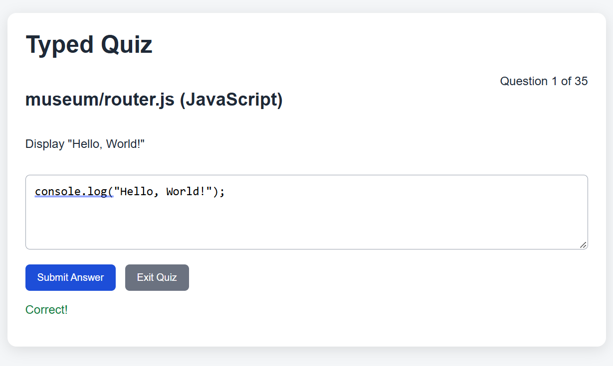
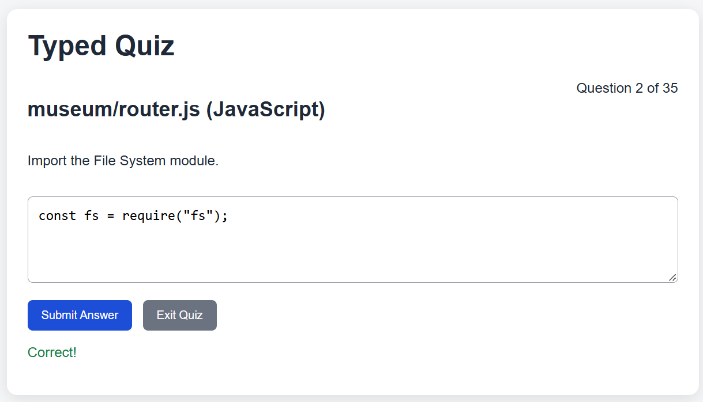
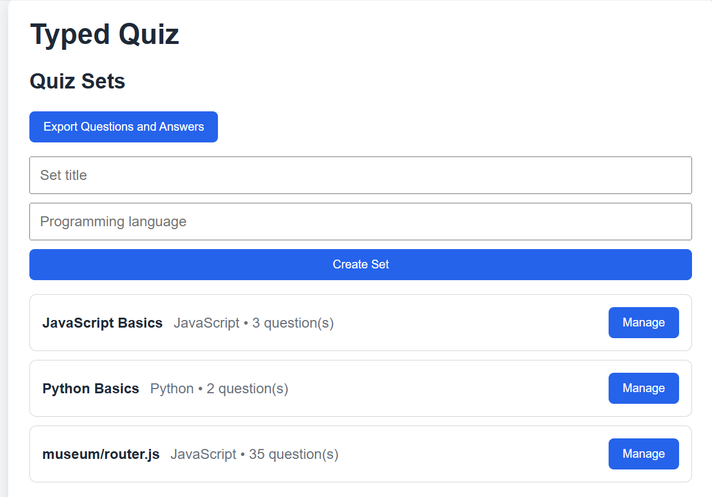
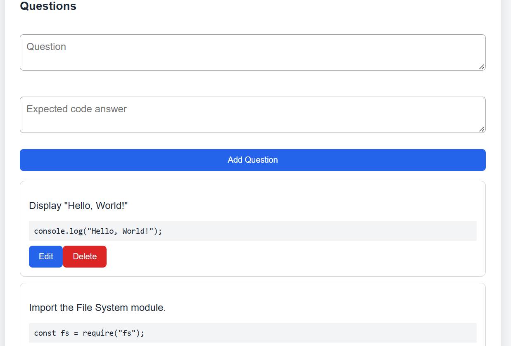
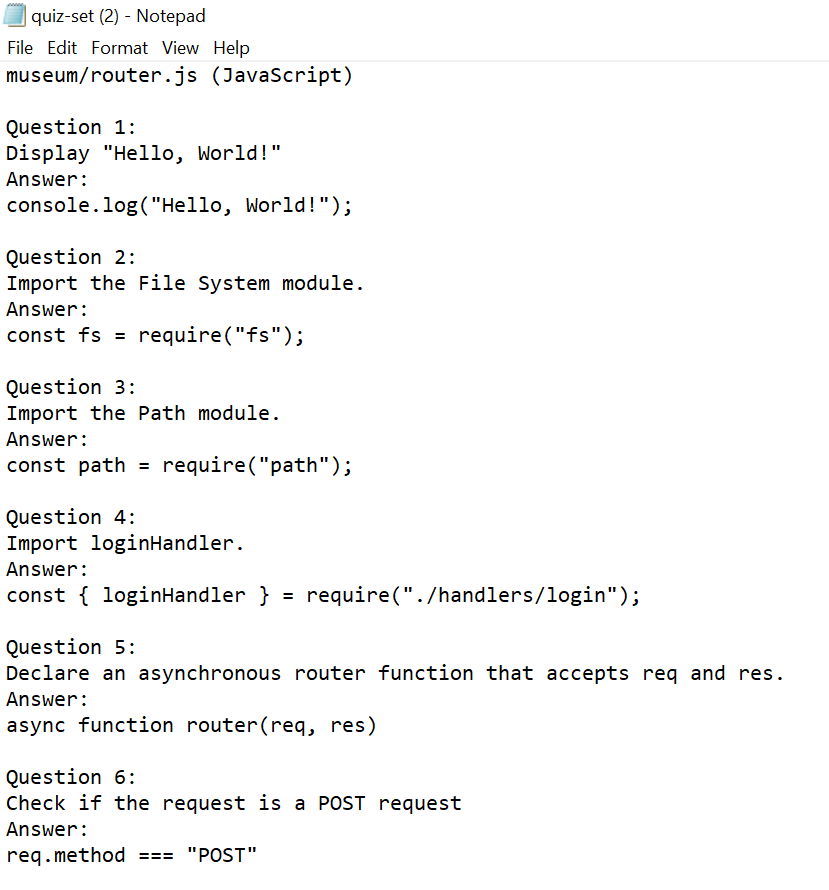

# Typed Quiz App

This app is helpful for learning programming language syntax.

---

## Install Dependencies

In the command terminal, run:

```bash
npm install
```
---

## Start the app:

To run a local instance, run the following in the terminal from the root directory:

```bash
npm start
```

## Project structure

- `server.js` starts the HTTP server.
- `src/app.js` configures Express and connects routes, services, and storage.
- `src/routes/` defines the HTTP endpoints.
- `src/services/` contains quiz, set, attempt, and export operations.
- `src/repositories/` contains JSON file persistence.
- `public/js/` separates API helpers, set management, and quiz-taking UI.
- `data/quizzes.json` stores quiz sets and attempts.

Run the automated tests with:

```bash
npm test
```

## Screenshots









